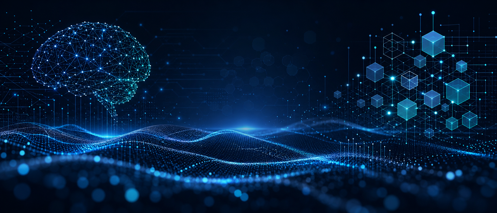

  

  <h1>Hey, I'm Muhammad Hassan 👋</h1>
  <h3>AI/ML Engineer · Data Scientist · Builder of Intelligent Systems</h3>

  

    
    
    
  

  

 

## ✦ The short version

I turn messy data and ambitious ideas into useful, intelligent products. My work sits at the intersection of **machine learning**, **computer vision**, **predictive analytics**, and **full-stack experimentation**—from detecting deepfakes to forecasting equipment failures and building polished mobile experiences.

> **Curious by default. Practical by design. Always building.**

## ⚡ What I work on

<table>
  <tr>
    <td width="50%" valign="top">
      <h3>🧠 Machine Learning</h3>
      Building predictive systems with supervised, unsupervised, and deep learning techniques.
    </td>
    <td width="50%" valign="top">
      <h3>👁️ Computer Vision</h3>
      Exploring visual intelligence, media authenticity, and deepfake detection.
    </td>
  </tr>
  <tr>
    <td width="50%" valign="top">
      <h3>📊 Data Science</h3>
      Turning raw data into clear insights through feature engineering, analysis, and visualization.
    </td>
    <td width="50%" valign="top">
      <h3>📱 Product Building</h3>
      Bringing ideas to life with Flutter, PostgreSQL, analytics, and thoughtful interfaces.
    </td>
  </tr>
</table>

## 🚀 Featured builds

| Project | What makes it interesting |
| --- | --- |
| [**Predictive Maintenance**](https://github.com/iammuhammadhassan/Predictive-Maintenance) | ML-powered early equipment failure detection to help reduce downtime. |
| [**Deep-Fake-Analyzer**](https://github.com/iammuhammadhassan/Deep-Fake-Analyzer) | Deep learning experiments for analyzing and detecting synthetic media. |
| [**CarAppWithDataBase**](https://github.com/iammuhammadhassan/CarAppWithDataBase) | Full-stack Flutter car marketplace with PostgreSQL, analytics, and a glassmorphic UI. |
| [**SoilSenseAi**](https://github.com/iammuhammadhassan/SoilSenseAi) | An AI-focused exploration of smarter, data-informed soil insights. |
| [**Practicing-Machine-Learning**](https://github.com/iammuhammadhassan/Practicing-Machine-Learning) | A growing laboratory of algorithms, experiments, and practical ML concepts. |

## 🧰 My toolkit

  
  
  
  
  
  
  
  
  
  
  

## 📈 GitHub at a glance

  
  

  

## 🌱 Right now

- Sharpening my skills in **MLOps, generative AI, and production-ready ML systems**.
- Turning experiments into projects that are useful, understandable, and easy to build on.
- Looking for interesting problems, thoughtful collaborators, and opportunities to create impact.

## 🤝 Let's build something meaningful

Have an idea involving AI, data, computer vision, or intelligent apps? I would love to hear about it.

  <a href="mailto:iam.muhammad.hassan0@gmail.com"><strong>✉️ iam.muhammad.hassan0@gmail.com</strong></a>
   
   
  Designed with curiosity · Built with code · Powered by continuous learning

